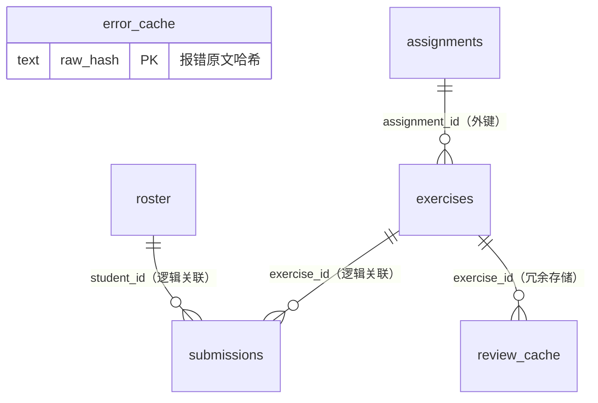

# 数据库表结构文档（assistant.db）

> 数据来源：`packages/server/src/persistence.ts`（建表语句见 `createPersistence()`）
> 存储：SQLite（better-sqlite3），文件位于 `packages/server/data/assistant.db`，WAL 模式
> 更新日期：2026-10-10

## 一、总览

数据库共 **7 张表**，分属两个子系统：

| 子系统 | 表 | 作用 |
|---|---|---|
| **错误监控**（v1，实时报错流） | `events`、`error_cache` | 学生运行报错的收集、聚合、LLM 解释缓存 |
| **作业评审**（v2，本次新增） | `roster`、`assignments`、`exercises`、`submissions`、`review_cache` | 花名册、作业发布、代码提交、LLM 评审与缓存 |

两套子系统**共用一个数据库文件但互不引用**（无跨系统外键/关联查询），共用同一身份前提：扩展身份页设置学号/姓名且通过 `roster` 名册校验后，上报与提交才放行。

> **历史备注**：曾有 `students` 学生注册表（上报时自动注册），2026-10-10 移除——它只写不读，且监控流与作业流同样强制实名过名册校验，身份信息 `roster` 已完整覆盖。旧 db 文件中的孤儿表无需迁移，放着无害。

### ER 关系图

## 二、监控子系统（v1）

### 1. events —— 错误/运行事件表

**作用**：监控流的核心表。学生运行 Python 报错或产生运行事件时，扩展上报一条事件，服务端解析分类后插入此表；仪表盘的实时监控、错误聚合、「优先帮助」列表都基于它计算。

| 字段 | 类型 | 约束 | 说明 |
|---|---|---|---|
| id | INTEGER | PRIMARY KEY AUTOINCREMENT | 自增主键 |
| student_id | TEXT | NOT NULL | 学号（上报身份，扩展侧经名册校验后携带） |
| class_id | TEXT | | 班级标识 |
| event_type | TEXT | NOT NULL CHECK IN ('diag','run') | 事件类型：diag=报错诊断 / run=运行 |
| raw_message | TEXT | NOT NULL | 原始报错/输出消息 |
| category | TEXT | NOT NULL | 错误大类（如 SyntaxError、ValueError） |
| subtype | TEXT | | 错误细分 |
| knowledge | TEXT | | LLM 生成的知识点解释 |
| file_path | TEXT | | 出错文件路径 |
| line_no | INTEGER | | 出错行号 |
| exit_code | INTEGER | | 进程退出码 |
| timestamp | DATETIME | NOT NULL | 事件发生时间（客户端） |
| created_at | DATETIME | DEFAULT CURRENT_TIMESTAMP | 入库时间（服务端） |
| code_snippet | TEXT | | 出错代码片段（可选） |

**索引**：`idx_events_student(student_id)`——按学生查事件；`idx_events_class_time(class_id, timestamp)`——按班级+时间做实时监控。

### 2. error_cache —— 错误解释缓存表

**作用**：同一段报错原文的解释只让 LLM 生成一次。key 是报错原文的哈希（`raw_hash`），命中计数用于统计。属于监控流的 LLM 解释缓存。

| 字段 | 类型 | 约束 | 说明 |
|---|---|---|---|
| id | INTEGER | PRIMARY KEY AUTOINCREMENT | 自增主键 |
| raw_hash | TEXT | UNIQUE NOT NULL | 报错原文哈希（缓存 key） |
| raw_message | TEXT | NOT NULL | 报错原文 |
| category | TEXT | NOT NULL | 错误大类 |
| subtype | TEXT | NOT NULL | 错误细分 |
| knowledge | TEXT | NOT NULL | 解释内容 |
| source | TEXT | DEFAULT 'llm' | 来源（llm / mock 兜底） |
| hit_count | INTEGER | DEFAULT 0 | 命中次数 |
| created_at | DATETIME | DEFAULT CURRENT_TIMESTAMP | 首次缓存时间 |
| updated_at | DATETIME | DEFAULT CURRENT_TIMESTAMP | 最近更新时间 |

**索引**：`idx_cache_hash(raw_hash)`（UNIQUE 列自建索引亦可达，此为显式补充）。

## 三、作业评审子系统（v2）

### 3. roster —— 花名册

**作用**：作业系统的**唯一身份权威**。教师通过 `POST /api/roster` 导入（每行「学号 姓名」），导入即整表替换（`replaceRoster` 事务内先 DELETE 再 INSERT）。身份校验（`POST /api/identity/validate`）、提交时的学号校验都以它为准。

| 字段 | 类型 | 约束 | 说明 |
|---|---|---|---|
| student_id | TEXT | PRIMARY KEY | 学号 |
| student_name | TEXT | NOT NULL | 姓名（以名册写法为准，扩展保存身份时以此规范） |
| created_at | INTEGER | NOT NULL | 导入时间（毫秒时间戳） |

### 4. assignments —— 作业（周）表

**作用**：一周作业一条记录。服务端同步时按 git 仓库里的 `week-N/` 目录自动创建（标题默认「第 N 周作业」，未发布），教师在 `#/admin` 设置标题/截止日期并发布。

| 字段 | 类型 | 约束 | 说明 |
|---|---|---|---|
| id | TEXT | PRIMARY KEY | 作业 ID（UUID，服务端生成） |
| title | TEXT | NOT NULL | 作业标题（可通过 PATCH 修改） |
| week | INTEGER | NOT NULL UNIQUE | 周次，全库唯一——与目录名 `week-N` 一一对应 |
| due_at | INTEGER | | 截止时间（毫秒时间戳，**仅展示，不拦截提交**） |
| is_published | INTEGER | DEFAULT 0 | 是否发布：0=草稿 1=已发布；未发布时学生不可见不可交 |
| created_at | INTEGER | NOT NULL | 创建时间（毫秒时间戳） |
| published_at | INTEGER | | 发布时间（取消发布置 NULL） |

### 5. exercises —— 练习题表

**作用**：每道题一条记录，从 git 仓库的 `week-N/*.py` 文件解析而来（题面 + 初始代码）。文件头部的 `exercise-id` 就是本表主键——同步时首次见到文件生成 UUID 入库，并回写注入到文件。文件内容变更会更新 `version_hash`（评审基准），文件删除/移出会置 `is_active=0`（下线）。

| 字段 | 类型 | 约束 | 说明 |
|---|---|---|---|
| id | TEXT | PRIMARY KEY | 练习 ID（UUID），即文件头注入的 exercise-id |
| assignment_id | TEXT | NOT NULL REFERENCES assignments(id) | 所属作业（**全库唯一的外键**） |
| order_no | INTEGER | NOT NULL | 作业内顺序（同步时按文件名排序重新编号） |
| filename | TEXT | NOT NULL | 文件名，如 `exercise-01.py` |
| problem_statement | TEXT | NOT NULL | 题面（元数据块与代码区标记之间的注释内容） |
| starter_code | TEXT | | 初始代码（「代码区」标记之后的内容，可为空） |
| test_cases_json | TEXT | | 测试用例 JSON（当前版本恒为 `[]`，预留） |
| version_hash | TEXT | NOT NULL | 版本指纹：sha256(题面 + 测试用例 + 初始代码) 截 16 位；参与评审缓存 key |
| is_active | INTEGER | DEFAULT 1 | 是否启用；仓库中文件被删则置 0（历史提交保留） |
| created_at | INTEGER | NOT NULL | 创建时间（毫秒时间戳） |

**索引**：`idx_exercises_assignment(assignment_id, filename)` UNIQUE——同一作业内文件名唯一，也是「按路径查题」（`findExerciseByPath`，id 头缺失时的对账依据）。

### 6. submissions —— 提交表

**作用**：学生每次代码提交一条记录，是评审、归档、仪表盘矩阵的数据源。**双端幂等**：服务端靠唯一索引 `(exercise_id, student_id, code_hash)` 去重，重复提交返回已有记录（终态直接回，unreviewed 重新入队评审）。

| 字段 | 类型 | 约束 | 说明 |
|---|---|---|---|
| id | TEXT | PRIMARY KEY | 提交 ID（UUID） |
| exercise_id | TEXT | NOT NULL | 题目 ID（逻辑关联 exercises.id，提交时由扩展从文件头读取） |
| student_id | TEXT | NOT NULL | 学号（逻辑关联 roster.student_id，服务端以名册校验为准） |
| student_name | TEXT | NOT NULL | 提交时姓名（冗余存储，取自名册） |
| code | TEXT | NOT NULL | 提交的代码全文（≤50KB） |
| code_hash | TEXT | NOT NULL | 代码哈希（幂等 key 的一环） |
| source | TEXT | NOT NULL | 提交方式：auto=运行自动提交 / manual=手动命令提交 |
| git_synced | INTEGER | DEFAULT 0 | 是否已归档到学生 git 分支；0 的记录由同步服务补推 |
| submitted_at | INTEGER | NOT NULL | 提交时间（毫秒时间戳） |
| review_json | TEXT | | 评审结果 JSON（`ReviewResult`：status/reason/reviewedAt/model/source）；NULL=待评审 |

**索引**：
- `idx_submissions_dedup(exercise_id, student_id, code_hash)` UNIQUE——幂等去重核心
- `idx_submissions_exercise(exercise_id)`——按题查全部学生提交

### 7. review_cache —— 评审缓存表

**作用**：相同（题目版本 + 代码）的评审结果直接复用，不重复调用 LLM。缓存 key 为 `sha256(exerciseId + versionHash + code)` 截断。**只缓存终态 pass / fail**；unreviewed 不入缓存（下次提交会重试评审）。命中时 `hit_count` 自增。

| 字段 | 类型 | 约束 | 说明 |
|---|---|---|---|
| cache_key | TEXT | PRIMARY KEY | sha256(exerciseId + versionHash + code)，评审缓存 key |
| exercise_id | TEXT | NOT NULL | 题目 ID（冗余存储，便于按题清理/统计） |
| version_hash | TEXT | NOT NULL | 题目版本指纹（冗余存储；题目改版后旧 key 自然失效） |
| status | TEXT | NOT NULL | 评审结论：pass / fail（终态才写入） |
| reason | TEXT | NOT NULL | LLM 给出的评审理由 |
| source | TEXT | NOT NULL | 评审来源：llm / mock（key 缺失时兜底）/ timeout 兜底 |
| model | TEXT | | 使用的模型名 |
| hit_count | INTEGER | DEFAULT 0 | 命中次数 |
| created_at | INTEGER | NOT NULL | 首次缓存时间（毫秒时间戳） |

> 与 `error_cache` 的区别：`error_cache` 缓存监控流的**错误解释**（key=报错原文哈希），`review_cache` 缓存作业流的**代码评审结论**（key=题目版本+代码哈希）。两套缓存独立设计，类型不通用。

## 四、表间关系汇总

| 关系 | 类型 | 说明 |
|---|---|---|
| assignments → exercises | 1 : N | **显式外键**（exercises.assignment_id REFERENCES assignments.id），作业删除/周次变更受外键约束 |
| exercises → submissions | 1 : N | 逻辑关联（无外键），提交时服务端校验 exercise 存在且 active |
| roster → submissions | 1 : N | 逻辑关联（无外键），提交时校验学号在名册；姓名从名册冗余进提交行 |
| exercises → review_cache | 1 : N | 冗余关联，便于按题清理缓存 |
| events → roster | 逻辑关联 | events.student_id 为学号，身份扩展侧经名册校验后携带 |

外键只有一条（assignments↔exercises）是有意为之：提交/评审链路追求写入性能与灵活性，关联完整性由服务端代码校验保证。

## 五、一次提交的数据流（表的变化顺序）

1. 学生运行 `week-01/exercise-01.py` → 扩展读文件头 `exercise-id`，连同身份 `POST /api/submissions`
2. 服务端校验：`exercises` 中存在且 active → `assignments` 中已发布 → `roster` 中学号存在
3. 幂等检查：`submissions` 按 `(exercise_id, student_id, code_hash)` 查重 → 重复则返回已有记录
4. 新提交 → INSERT `submissions`（`review_json=NULL`，`git_synced=0`），SSE 推送仪表盘
5. 异步两路：①评审——先查 `review_cache`，未命中调 LLM，终态写 `review_cache` 并 UPDATE `submissions.review_json`；②归档——写入学生 git 分支后置 `git_synced=1`
6. 服务端重启时：`review_json IS NULL` 的提交被重新入队评审（防卡死），`git_synced=0` 的补推归档
