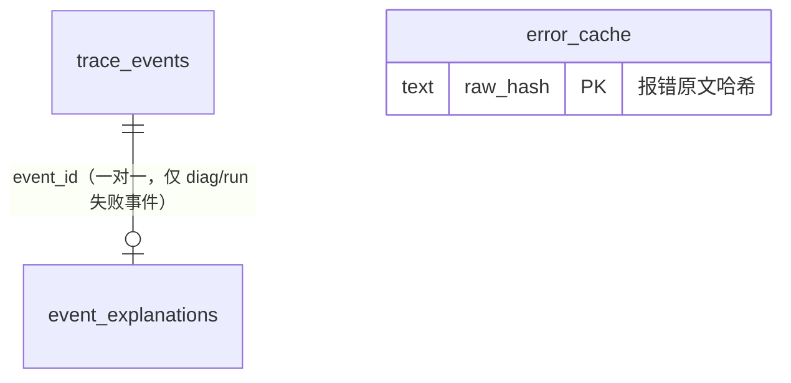

# 数据库表结构文档（assistant.db）

> 数据来源：`packages/server/src/persistence.ts`（建表语句见 `createPersistence()`）
> 存储：SQLite（better-sqlite3），文件位于 `packages/server/data/assistant.db`，WAL 模式
> 更新日期：2026-10-16（L1 统一入库重构）

## 一、总览

数据库共 **6 张表**，分属三个子系统：

| 子系统 | 表 | 作用 |
|---|---|---|
| **L1 事件流水**（v3，本次重构） | `trace_events`、`event_explanations` | 全 surface 事件原样入库（原始事实表）+ LLM 解释侧表（一对一富化） |
| **实时监控** | `error_cache` | 错误解释三层缓存中的持久层 |
| **作业评审**（v2） | `roster`、`review_cache`、`student_tokens` | 花名册（身份唯一权威）、LLM 评审缓存、Git 凭证 |

三套子系统**共用一个数据库文件但互不引用**（无跨系统外键/关联查询）。学生身份统一前提：扩展身份页设置学号/姓名且通过 `roster` 名册校验后，上报与提交才放行。

> **历史备注**：
> - `students`（只写不读）2026-10-10 移除；`assignments`/`exercises`/`submissions`（作业域，提交流水以学生分支 git 历史为准）随 notify 退役一并 DROP；`events`（旧监控事件表，无 event_id 无法幂等迁移）2026-10-16 随 L1 统一入库退役，**历史数据不迁移**。
> - 旧 `L1-data` 文件归档目录同步退役，归档落点改为数据库（协议与客户端位点零改动）。

### ER 关系图

## 二、L1 事件流水子系统（v3）

### 1. trace_events —— 事件原始事实表

**作用**：全链路唯一事实源。`/api/events` 实时上报与 `/api/trace/archive` 批量归档共用此表，按 `event_id` 幂等去重（`INSERT OR IGNORE`）。所有 surface（edit/run/chat/debug/diag/behavior）原样入库：payload 是客户端事件的 JSON 原文，服务端不做结构改写。实时看板与 LLM 解释只针对 diag/run 事件，归档通道只写本表。

| 字段 | 类型 | 约束 | 说明 |
|---|---|---|---|
| event_id | TEXT | PRIMARY KEY | 客户端事件 ID（`<surface>:<ULID>`，幂等 key） |
| student_id | TEXT | NOT NULL | 学号（扩展侧经名册校验后携带） |
| student_name | TEXT | NOT NULL | 姓名（冗余存储；归档批次头可缺省回退学号） |
| class_id | TEXT | NOT NULL DEFAULT 'default' | 班级标识 |
| surface | TEXT | NOT NULL CHECK IN ('edit','run','chat','debug','diag','behavior') | 事件面 |
| kind | TEXT | NOT NULL | 事件类型（如 execution_error、user_message） |
| ts | TEXT | NOT NULL | 事件发生时间（ISO-8601 UTC，客户端时钟） |
| session_id | TEXT | | 客户端会话 ID（chat 事件区分多机上下文） |
| payload | TEXT | NOT NULL | 事件负载 JSON 原文（原样存储，不改写） |
| date | TEXT | NOT NULL | 事件发生日期 YYYY-MM-DD（UTC，取自 ts；归档通道取批次头 date） |
| ingested_at | TEXT | DEFAULT datetime('now') | 入库时间（服务端时钟，秒精度） |

**索引**：`idx_trace_student_surface_ts(student_id, surface, ts)`——画像按学生+面取时间线；`idx_trace_class_ts(class_id, ts)`——按班级+时间检索；`idx_trace_date(date)`——按日统计。

### 2. event_explanations —— LLM 解释侧表

**作用**：diag/run 失败事件经 LLM 解释后的富化结果，与 `trace_events` 一对一（共享 event_id）。实时通道（/api/events）与原始行同事务写入；归档通道不产生解释行。第二阶段画像统计分类分布时以本表为准。

| 字段 | 类型 | 约束 | 说明 |
|---|---|---|---|
| event_id | TEXT | PRIMARY KEY | 对应 trace_events.event_id |
| category | TEXT | NOT NULL | 错误大类（run 事件以静态映射为准，如「运算错误」） |
| subtype | TEXT | NOT NULL | 错误细分（如「除数为0」） |
| knowledge | TEXT | NOT NULL | 知识点解释 |
| source | TEXT | NOT NULL | 解释来源：llm=真实 LLM 成功 / mock=兜底（无 key、上游失败、解析失败） |

## 三、实时监控子系统

### 3. error_cache —— 错误解释缓存表

**作用**：同一段报错原文的解释只让 LLM 生成一次。三层缓存（内存 → SQLite → LLM）中的持久层，key 是报错原文的哈希（`raw_hash`），命中计数用于统计。`source` 字段自 v3 起如实标注（llm/mock），与 `event_explanations.source` 同口径。

| 字段 | 类型 | 约束 | 说明 |
|---|---|---|---|
| id | INTEGER | PRIMARY KEY AUTOINCREMENT | 自增主键 |
| raw_hash | TEXT | UNIQUE NOT NULL | 报错原文哈希（缓存 key） |
| raw_message | TEXT | NOT NULL | 报错原文 |
| category | TEXT | NOT NULL | 错误大类 |
| subtype | TEXT | NOT NULL | 错误细分 |
| knowledge | TEXT | NOT NULL | 解释内容 |
| source | TEXT | DEFAULT 'llm' | 来源（llm / mock 兜底） |
| hit_count | INTEGER | DEFAULT 0 | 命中次数 |
| created_at | DATETIME | DEFAULT CURRENT_TIMESTAMP | 首次缓存时间 |
| updated_at | DATETIME | DEFAULT CURRENT_TIMESTAMP | 最近更新时间 |

**索引**：`idx_cache_hash(raw_hash)`（UNIQUE 列自建索引亦可达，此为显式补充）。

## 四、作业评审子系统（v2）

### 4. roster —— 花名册

**作用**：作业系统的**唯一身份权威**。教师通过 `POST /api/roster` 导入（每行「学号 姓名」），导入即整表替换（`replaceRoster` 事务内先 DELETE 再 INSERT）。身份校验（`POST /api/identity/validate`）与提交时的学号校验都以它为准。

| 字段 | 类型 | 约束 | 说明 |
|---|---|---|---|
| student_id | TEXT | PRIMARY KEY | 学号 |
| student_name | TEXT | NOT NULL | 姓名（以名册写法为准，扩展保存身份时以此规范） |
| created_at | INTEGER | NOT NULL | 导入时间（毫秒时间戳） |

### 5. review_cache —— 评审缓存表

**作用**：相同（文件路径 + 评审输入）的评审结果直接复用，不重复调用 LLM。缓存 key 为 `sha256(文件路径 + 评审输入内容)`。**只缓存终态 pass / fail**；unreviewed 不入缓存（幂等命中时自动重试评审）。命中时 `hit_count` 自增。

| 字段 | 类型 | 约束 | 说明 |
|---|---|---|---|
| cache_key | TEXT | PRIMARY KEY | sha256(文件路径 + 评审输入内容)，评审缓存 key |
| status | TEXT | NOT NULL | 评审结论：pass / fail（终态才写入） |
| reason | TEXT | NOT NULL | LLM 给出的评审理由 |
| source | TEXT | NOT NULL | 评审来源：llm / mock（key 缺失时兜底）/ timeout 兜底 |
| model | TEXT | | 使用的模型名 |
| hit_count | INTEGER | DEFAULT 0 | 命中次数 |
| created_at | INTEGER | NOT NULL | 首次缓存时间（毫秒时间戳） |

> 与 `error_cache` 的区别：`error_cache` 缓存监控流的**错误解释**（key=报错原文哈希），`review_cache` 缓存作业流的**代码评审结论**（key=文件路径+评审输入）。两套缓存独立设计，类型不通用。

### 6. student_tokens —— 学生 Git 凭证表

**作用**：花名册导入时联动 Gitea API 批量创建学生账户，生成的 token 随身份校验响应下发（学生零感知）。按学号一对一。

| 字段 | 类型 | 约束 | 说明 |
|---|---|---|---|
| student_id | TEXT | PRIMARY KEY | 学号 |
| token | TEXT | NOT NULL | Gitea 访问令牌 |

## 五、表间关系汇总

| 关系 | 类型 | 说明 |
|---|---|---|
| trace_events → event_explanations | 1 : 0..1 | 仅 diag/run 失败事件有解释行；幂等命中（重复上报）不重复写解释 |
| trace_events → roster | 逻辑关联 | trace_events.student_id 为学号，扩展侧经名册校验后携带 |
| roster → student_tokens | 1 : 1 | 花名册导入时联动创建 |

无跨子系统外键，关联完整性由服务端代码校验保证（写多读少的流水表场景，追求写入性能）。

## 六、一次实时上报的数据流（表的变化顺序）

1. 学生触发事件 → 扩展封装 TraceEvent（id/surface/kind/payload）原样 `POST /api/events`
2. 服务端校验：id/surface/kind 格式 → student_id 白名单与名册校验
3. `INSERT OR IGNORE trace_events`（幂等去重核心）；diag/run 失败事件先经三层缓存获取解释，同事务写 `event_explanations`
4. 幂等命中（duplicated=true）：不解释、不推看板（典型场景：归档补传先到）
5. diag/run 事件再进内存状态机并 SSE 推看板；其他 surface 到此为止

## 七、一次批量归档的数据流

1. VS Code 扩展激活 → 读归档位点（本地文件已上传字节偏移）→ 增量切片按 surface/date 分批 `POST /api/trace/archive`
2. 服务端校验批次头（student_id/class_id 白名单、surface 枚举、date 格式、events 非空）
3. `insertTraceEvents` 单事务批量 `INSERT OR IGNORE` → 返回 `{ accepted, duplicated }`
4. 客户端据响应推进位点；失败位点不推进，下次激活断点续传
5. 只写 `trace_events`，不解释、不推看板（spec §4.2）
